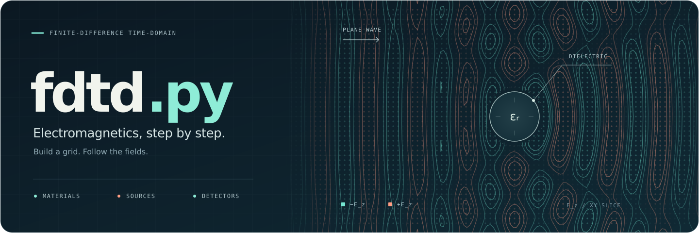

[](https://pypi.python.org/pypi/fdtd.py/)
[](https://pypi.python.org/pypi/fdtd.py/)
[](https://pypi.python.org/pypi/fdtd.py/)
[](https://tiagovla.github.io/fdtd.py/)
[](https://doi.org/10.5281/zenodo.4648395)

# FDTD Framework for Electromagnetic Simulations

<p align="center">
  
</p>

## Installation
```bash
pip install fdtd.py
```

## Supported Python versions

Python 3.9 through 3.15.

## Example
```python

"""Voltage source + resistor example."""

from fdtd import Brick, Grid, Material, Resistor, SineWaveform
from fdtd import VoltageSource as VSource
from fdtd import VoltageDetector as VDetector

PEC = Material(name="PEC", sigma_m=1e10)
grid = Grid(shape=(10, 10, 10), spacing=1e-3, courant_factor=0.9)

print("Creating objects...")
brick1 = Brick(*(4e-3, 2e-3, 8e-3), *(6e-3, 8e-3, 8e-3), PEC)
brick2 = Brick(*(4e-3, 2e-3, 4e-3), *(6e-3, 8e-3, 4e-3), "PEC")
v_source = VSource(
    *(4e-3, 2e-3, 4e-3),
    *(6e-3, 2e-3, 8e-3),
    waveform=SineWaveform(frequency=1e9),
    resistance=50,
)
resistor = Resistor(*(4e-3, 8e-3, 4e-3), *(6e-3, 8e-3, 8e-3), 50)
v_detector = VDetector(*(4e-3, 5e-3, 4e-3), *(6e-3, 5e-3, 8e-3))

print("Adding components to grid...")
components = [brick1, brick2, v_source, resistor, v_detector]
for comp in components:
    grid.add(comp)

print("Running simulation...")
grid.run(n_steps=5000)
v_detector.plot()
grid.plot_geometry()
```


## Documentation

Read the [published documentation](https://tiagovla.github.io/fdtd.py/).

Preview the MkDocs Material site locally:

```bash
uv run --extra docs mkdocs serve
```

Build the documentation with validation:

```bash
uv run --extra docs mkdocs build --strict
```

### References
[1] A. Z. Elsherbeni and V. Demir, The finite-difference time-domain method for electromagnetics, 2nd Edition. Edison, NJ: SciTech Publishing, an imprint of the IET, 2016.
